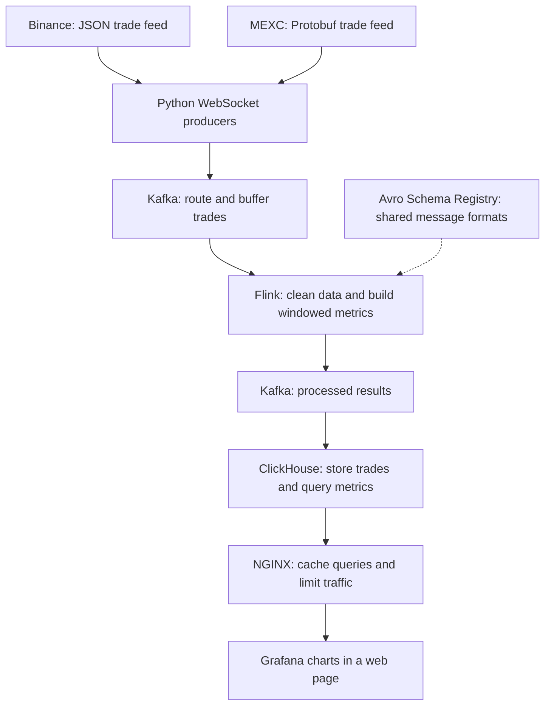

# Real-Time Crypto Analytics Pipeline

**Live trades. Clear charts. One streaming data pipeline.**

This project turns live crypto trades into charts you can watch as the market moves. It takes trade data from **Binance and MEXC**, cleans it, builds market metrics, and stores the results for fast queries.

Trades reach the dashboard in about **2–5 seconds end to end** in the project setup.

## What I built

I built an end-to-end streaming ETL pipeline, from live exchange feeds to a web dashboard. ETL means taking data in, changing it into a useful form, and saving it.

The pipeline answers three simple questions:

- What is the price doing?
- How much is being traded?
- How much is the price moving up and down?

The charts are inspired by tools like TradingView. This project focuses on the data systems behind those charts.

## How it works

1. **Collect trades.** Python opens live WebSocket feeds from Binance and MEXC. It reads JSON and Protobuf messages.
2. **Route the data.** Kafka holds the trade events. Busy trading pairs get their own partitions, or lanes, so their traffic can be handled separately.
3. **Clean and calculate.** Flink puts both feeds into a shared format. It then calculates market metrics over time windows.
4. **Store the results.** Flink sends results back to Kafka. ClickHouse reads them and saves them in tables built for analytics.
5. **Show the charts.** Grafana queries the data and shows it in a web page. NGINX sits in front to cache repeat queries and limit traffic.

## At a glance

| Item | Project detail |
| --- | --- |
| Data sources | Binance and MEXC live trade feeds |
| End-to-end delay | About 2–5 seconds in the project setup |
| Raw Kafka topics | `binance_raw` and `mexc_raw` |
| Partitions | 10 per raw topic |
| Flink checkpoints | Every 1 second |
| Query cache | 2-second TTL in NGINX |
| Hosting | Docker on an Oracle Cloud VM |

## Main design choices

### Give busy pairs their own lanes

BTC, ETH, SOL, SUI, and CHIP are routed to dedicated Kafka partitions, numbered 0–4. Other pairs use hash-based routing across partitions 5–9.

This separates the busiest pairs from the rest. The split can be tuned as traffic changes.

### Clean the data in steps

Flink uses three layers:

- **Bronze:** raw events from the feeds.
- **Silver:** clean events with a shared format.
- **Gold:** metrics built from groups of trades over time.

Flink calculates the base metrics. ClickHouse views calculate other values from those results, such as net order flow. This keeps the work split between stream processing and database queries.

### Build useful market metrics

| Metric | What it tells us |
| --- | --- |
| OHLC | The first, highest, lowest, and last price in a time window |
| VWAP | The average trade price, weighted by trade size |
| Standard deviation | How widely prices vary in a time window |
| Volume | How much was traded |

Custom Java aggregate functions handle OHLC values and population standard deviation, including windows where prices do not change.

### Save progress for recovery

Flink saves a checkpoint every second. The checkpoint files use persistent Docker volumes so they can survive container rebuilds when the volumes are kept.

The pipeline uses **at-least-once processing**. This means a recovery can replay events. It does not guarantee that every trade is counted only once. Duplicate handling matters when checking totals.

### Keep chart queries fast

ClickHouse uses Kafka Engine tables to read results. Materialized views move those results into MergeTree tables. Rollup views support chart queries.

NGINX caches ClickHouse query responses for two seconds and rate-limits requests. This reduces repeat database work and helps control traffic spikes. Cached charts may show slightly older data.

## Tech stack

| Area | Tools |
| --- | --- |
| Ingestion | Python, WebSockets, Protobuf |
| Messaging | Apache Kafka, Avro, Confluent Schema Registry |
| Processing | Apache Flink, PyFlink, Flink SQL, Java UDAFs |
| Storage | ClickHouse, Kafka Engine, MergeTree, materialized views |
| Charts and UI | Grafana, JavaScript, HTML, CSS |
| Infrastructure | Docker, NGINX, Oracle Cloud VM |

## What this project shows

- Building a streaming ETL pipeline across two data sources.
- Choosing how to route events through Kafka partitions.
- Cleaning data and computing metrics with stateful stream processing.
- Designing an analytics store for live dashboards.
- Using checkpoints, caching, and rate limits to support reliable operation.

## Scope and limits

This is a market-data analytics project, not a trading or order-execution system. The feed contains **trade events**, not user clickstream events.

The stated latency depends on exchange feeds, network speed, server load, and dashboard refresh settings. Checkpoints help recover saved processing state, but they do not prove zero data loss across the whole system.

